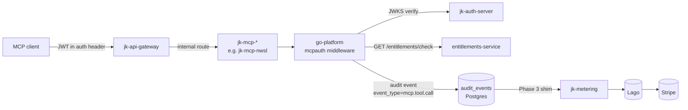
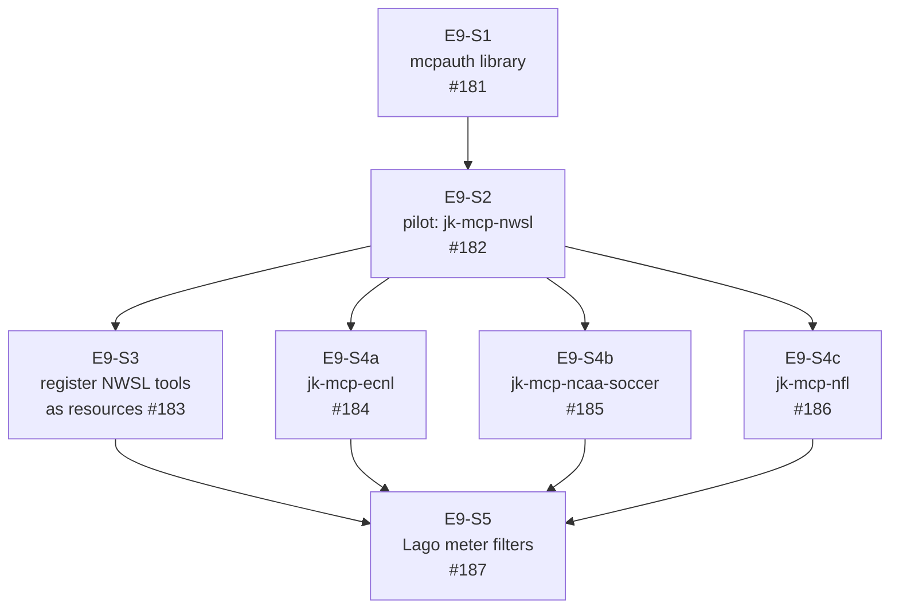

# MCP tool gating (Epic 9)

Shared middleware that gates every `jk-mcp-*` server on identity +
entitlement + metering. The highest-leverage platform epic in Phase 5
— one middleware, four MCP servers wired through it, every tool
invocation reflected in the Lago invoice via the Phase 3 shim.

- **Epic:** [identity-platform-go#146](https://github.com/jedi-knights/identity-platform-go/issues/146)
- **Phase:** 5
- **Milestone:** Epic 9 — MCP Tool Gating
- **Status:** ready to start — 0 of 7 stories merged (as of 2026-10-13)

## Why it exists

[`agentic-posture.md`](agentic-posture.md) locks the posture: every
paid agentic surface must authenticate, authorize, and meter per
invocation. Phase 3 shipped the metering plumbing (`jk-metering` +
`jk-metering-ingest`). Phase 5 brings the client-facing surfaces
(`jk-mcp-*`) into that pipeline so an MCP tool call becomes a
billable, bounded operation like any other.

Without the shared middleware every MCP server would re-implement the
same JWT verification + entitlement check + meter emit code, drift
would compound across servers, and adding a new MCP server would be a
multi-week integration rather than a one-import plug-in.

## Pipeline position

The middleware is a client of two existing surfaces (JWKS +
`entitlements-service`) and a producer of one (`audit_events`). It
does not call Lago directly — the Phase 3 shim handles that end of the
pipeline.

## Story dependency graph

E9-S1 is the dependency root — nothing else can land until the library
exists. E9-S2 is the pilot wire-up that proves the pattern. E9-S3 and
E9-S4a/b/c can parallelise once the pilot is green. E9-S5 is terminal:
pricing lands after resources exist.

## Stories

### E9-S1 — Build shared mcpauth library (size: L, #181)

- Library at `go-platform/mcpauth/`, exports one middleware function.
- Validates identity-platform JWT via JWKS.
- Calls `entitlements/check` for `mcp:<server>:<tool>` on every
  invocation.
- Emits meter event with `resource_id` property on success.
- Denial returns a transport-shaped MCP error, not raw 403.
- Black-box tested through the public API per
  `rules/black-box-testing.md`.

**Decisions to make before coding** — the resume anchor:

1. **MCP transport.** `mark3labs/mcp-go` vs `anthropic/go-mcp`? Pick
   whichever each `jk-mcp-*` server is on today; verify consistency
   across the four servers before authoring the middleware interface.
   The error envelope shape (acceptance criterion for denial) is
   transport-specific.
2. **JWKS caching.** Share the gateway's JWKS cache or ship an
   independent one? Gateway already hits
   `jk-auth-server.internal:8080/.well-known/jwks.json` — two caches =
   two cache-rotation windows to reason about.
3. **Entitlements call.** Synchronous HTTP to `entitlements-service`
   per invocation vs cached decision with a TTL. Default synchronous;
   the TTL cache is a later optimisation that needs an invalidation
   strategy before shipping.
4. **Meter event schema.** Reuse `go-platform/audit.Event` so the
   Phase 3 shim consumes with zero schema changes.
   `event_type = mcp.tool.call`, `resource_id = mcp:<server>:<tool>`,
   `subject_id` + `client_id` from the verified JWT, tool-specific
   attrs under `attrs`.
5. **Resource ID convention.** `mcp:<server>:<tool>` matches the
   acceptance criterion but requires alignment with
   `entitlements-service`'s resource registry (E9-S3). Fix the
   format before S1 ships so S3 doesn't re-derive it.

### E9-S2 — Wire middleware into jk-mcp-nwsl (size: S, #182)

The pilot. Everything learned here becomes the template for S4a/b/c.

- Wire in `jk-mcp-nwsl/main.go`.
- Unentitled request returns MCP-native error.
- Entitled request returns tool response and emits a meter event.
- End-to-end CI test covering both paths.

### E9-S3 — Register NWSL tools as resources (size: S, #183)

- One `resources` row per NWSL tool (`mcp:jk-mcp-nwsl:<tool_name>`).
- Grouped into a "NWSL Full" bundle.
- Bundle linked to plans via `plan_bundles` in Lago.
- Idempotent seed script covering all tools.

### E9-S4 — Wire remaining MCP servers (size: S each, parallelisable)

Three structurally identical stories after S2 proves the pattern:

- **E9-S4a** jk-mcp-ecnl (#184)
- **E9-S4b** jk-mcp-ncaa-soccer (#185)
- **E9-S4c** jk-mcp-nfl (#186)

Each repeats the S2 wire-up and the S3 resource registration against
its own tool list.

### E9-S5 — Lago meter filters for pricing (size: S, #187)

- `mcp_tool_calls` billable metric with per-tool filter rules.
- Free-tier tools priced at 0 (counted, not charged).
- Paid-tool pricing verified via test invocation → invoice preview.
- Pricing changes land through Lago admin, no code deploy.

## Resume state (last updated 2026-10-13)

- **Where to start:** E9-S1 (#181). No stories merged. No
  `go-platform/mcpauth/` directory exists today.
- **Nothing is in flight.** No open PRs tagged `epic:9-mcp`.
- **Prerequisites that already exist:**
  - identity-platform JWKS endpoint live at
    `jk-auth-server.internal:8080/.well-known/jwks.json`
  - `entitlements-service` exists in the fleet (see
    `services/entitlements-service/` on identity-platform-go)
  - Phase 3 metering pipeline shipped — the shim drains `audit_events`
    → Lago → Stripe
  - All four `jk-mcp-*` servers deployed and reachable through the
    gateway
- **Resume checklist for a new session (any machine):**
  1. `gh issue list --repo jedi-knights/identity-platform-go --label epic:9-mcp --state open`
  2. Read E9-S1 (#181) acceptance criteria.
  3. Resolve the five "Decisions to make before coding" items above.
  4. Spawn the architect agent via `/architect design` with the
     resolved decisions as context, then open the first PR against
     `jedi-knights/go-platform` adding `mcpauth/`.

## Related docs

- [`agentic-posture.md`](agentic-posture.md) — the posture doctrine
- [`jk-metering.md`](jk-metering.md) — the sink end of the pipeline
- [`billing-and-metering-setup.md`](billing-and-metering-setup.md) —
  design-time sequence
- [`jk-mcp-ecnl.md`](jk-mcp-ecnl.md),
  [`jk-mcp-nwsl.md`](jk-mcp-nwsl.md) — per-server trajectory pages
- [`identity-platform-go.md`](identity-platform-go.md) — the identity
  fleet this middleware authenticates against
